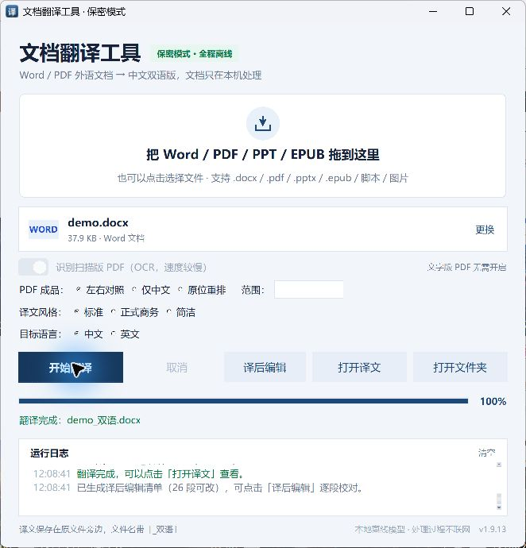

# 文档翻译工具

Windows 桌面文档翻译工具。拖入文件即可生成双语文档，支持本地离线翻译、扫描件 OCR 和逐段复核。



## 下载并开始

1. 在 [GitHub Releases](../../releases) 下载最新的 Windows x64 ZIP，完整解压。
2. 双击「打开-联网版.bat」，拖入文件，点击「开始翻译」。可以先试试包内「样例」目录里的演示文件。
3. 译文保存在原文件旁。部分格式可通过「译后编辑」逐段修改译文。

支持 Word（DOCX）、PDF、PPTX、EPUB、字幕（SRT/VTT）、特定结构的 JSON 脚本和 Excel/T++ 工作簿，以及 PNG、JPEG、BMP、WebP 图片。PDF 支持左右对照、仅译文和原位重排。扫描件需要启用 OCR，复杂版面与机器译文建议复核。

[演示原文](samples/示例-英文报告.docx)中的一组离线翻译成品

> Artificial intelligence is transforming the way we learn, work, and communicate.
>
> 人工智能正在改变我们学习、工作和沟通的方式。

## 离线翻译与数据去向

- **保密模式**使用本机模型。按[模型获取说明](保密模式说明.txt)配置 `models/` 后，双击「打开-保密模式.bat」。英译中使用 OPUS-MT，中译英及更多语种需要另行获取 NLLB（CC BY-NC 4.0）。
- **本地大模型**使用本机 Ollama。请选择本地权重，服务不可用时仅回退本机离线小模型。缺少模型时会提示安装。该档沿用普通模式的缓存与翻译记忆设置。
- **免费云端、DeepL 和自托管**会将文本发送到所选服务。免费接口可能变动，DeepL 需要自己的 API Key。

保密模式翻译不联网、不写翻译缓存。运行日志记录时间、进度等元信息。译文、自检报告和译后编辑清单可能包含文档内容，可在原文件旁找到。提交问题时请使用合成样例，并移除真实文档内容、密钥和本机路径。

## 从源码运行

需要 Windows x64 和 [Python 3.11](https://www.python.org/downloads/)。在源码根目录打开 PowerShell。

```powershell
py -3.11 -m venv .venv
.\.venv\Scripts\python.exe -m pip install -r requirements.txt
.\.venv\Scripts\python.exe app.py
```

命令行示例

```powershell
.\.venv\Scripts\python.exe app.py --help
.\.venv\Scripts\python.exe app.py --offline --convert ".\samples\示例-英文报告.docx"
```

## 测试与构建

```powershell
.\.venv\Scripts\python.exe -m pytest -q -m "not slow"
.\.venv\Scripts\python.exe -m pip install -r requirements-build.txt
.\.venv\Scripts\python.exe build_dist.py --zip
.\.venv\Scripts\python.exe verify_dist.py
```

构建产物位于 `分发/`。配置离线模型后，可以运行全量测试 `python -m pytest -q`。开发机使用 `--models --zip` 可在本地制作含模型的包，分发前请查阅模型许可。

## 许可

项目源码按 [AGPL-3.0](LICENSE) 发布。依赖、OCR 组件及翻译模型的上游许可见[第三方组件与模型](THIRD_PARTY_NOTICES.md)。每个 Release 的源码标签对应其 Windows 分发包。[更新记录](CHANGELOG.md)
